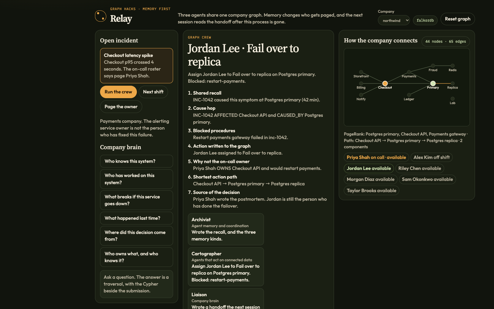
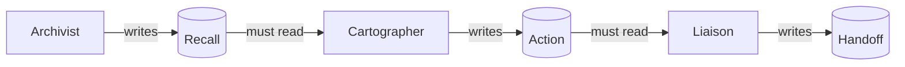
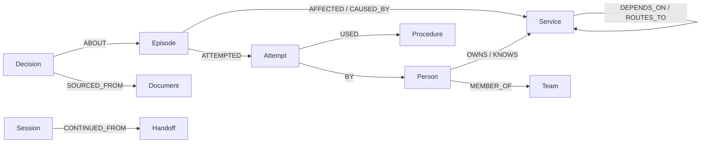

# Relay

Three agents share one company graph. Memory changes who gets paged, and the next session reads the handoff after this process is gone.

[](https://github.com/Anusha0501/relay/actions/workflows/test.yml)

FalkorDB is the shared context. The Archivist writes recall. The Cartographer reads that recall and writes an action. The Liaison reads the action and writes a handoff. Nothing is passed between agents in process memory.



## The wrong page

Checkout p95 crosses four seconds. The roster says page Priya Shah, the on-call owner of Checkout API. Her runbook restarts Payments gateway.

That restart already failed. Incident 1042 was caused by Postgres primary, and the person who failed it over last time was Jordan Lee. Riley Chen also knows the database and has never done the failover. Relay pages Jordan, records the sources, and leaves a handoff the next shift can read.




<details>
<summary>What each agent is allowed to see</summary>

| Agent | Reads | Writes |
| --- | --- | --- |
| Archivist | prior episodes, failed attempts, open handoffs | `Recall`, episodic, semantic, and procedural memory |
| Cartographer | the `Recall` for this session | `Action` |
| Liaison | the `Action` for this session | `Handoff`, with the decision sources attached |

The Cartographer query starts with `MATCH (recall:Recall {session_id})`. If that node is missing, the agent stops. The Liaison does the same with `Action`.

</details>

## Run it

Docker, Python 3.12, and [uv](https://docs.astral.sh/uv/).

```bash
docker compose up -d
uv sync
FALKORDB_HOST=localhost uv run uvicorn app.main:app --host 127.0.0.1 --port 8080
```

Open [http://127.0.0.1:8080](http://127.0.0.1:8080).

1. **Run the crew.** Jordan Lee, fail over to the replica. Priya stays on the roster.
2. **Next shift.** A new session continues the open handoff.
3. **Page the owner.** The contrast case. It restarts Payments and writes nothing.
4. Mark the failover **failed**. The next crew blocks that procedure and promotes the read replica instead. The assignee stays Jordan.
5. Switch the company to **brightpath**. Maya Chen owns Search. The crew pages Noah Williams to roll back the ranking model.

FalkorDB Browser is on port 3000. The graphs are `relay_northwind` and `relay_brightpath`.

```bash
FALKORDB_HOST=localhost uv run pytest -q
```

On Apple Silicon, omit `FALKORDB_HOST`. The app uses embedded FalkorDBLite and stores the graph in `data/relay.db`.

## Graph

Two tenants, one schema. A node never crosses from Northwind into Brightpath.



<details>
<summary>Labels</summary>

`Person`, `Team`, `Service`, `Procedure`, `Episode`, `Attempt`, `Decision`, `Document`, `Session`, `Recall`, `Memory`, `Action`, `Handoff`, `Meta`.

</details>

<details>
<summary>How the crew chooses</summary>

1. An open handoff wins when its procedure is not blocked and the person is available.
2. Otherwise, a successful attempt on the suspected cause, excluding blocked procedures.
3. Otherwise, the lowest-ranked procedure on that cause that is not blocked.
4. The assignee is someone who has done it, then an available person who knows the service. Jordan comes before Riley.

PageRank, betweenness, weakly connected components, and shortest path are computed on the service graph. If an algorithm call fails, the crew falls back and the page does not change.

The queries are in [`cypher/queries.cypher`](cypher/queries.cypher) and served at `GET /api/cypher`.

</details>

## API

| Method | Path | Body |
| --- | --- | --- |
| `GET` | `/api/health` | |
| `GET` | `/api/cypher` | |
| `POST` | `/api/tenants/{tenant}/reset` | |
| `GET` | `/api/tenants/{tenant}/graph` | |
| `GET` | `/api/tenants/{tenant}/memory` | |
| `POST` | `/api/tenants/{tenant}/incidents` | `{service, symptom, policy}` |
| `POST` | `/api/tenants/{tenant}/sessions/{id}/outcome` | `{result, note}` |
| `POST` | `/api/tenants/{tenant}/ask` | `{question, service}` |

`policy` is `memory` or `owner`. Questions: `who_knows`, `who_worked`, `blast`, `last_time`, `decision`, `ownership`.

## Tracks

- **Agent Memory and Coordination.** Recall, action, and handoff are graph nodes. The next session continues the handoff.
- **Agents That Act on Connected Data.** Cause, blast radius, and shortest path decide the action.
- **Company Brain.** Who knows a service, who has worked it, and which document a decision came from.
